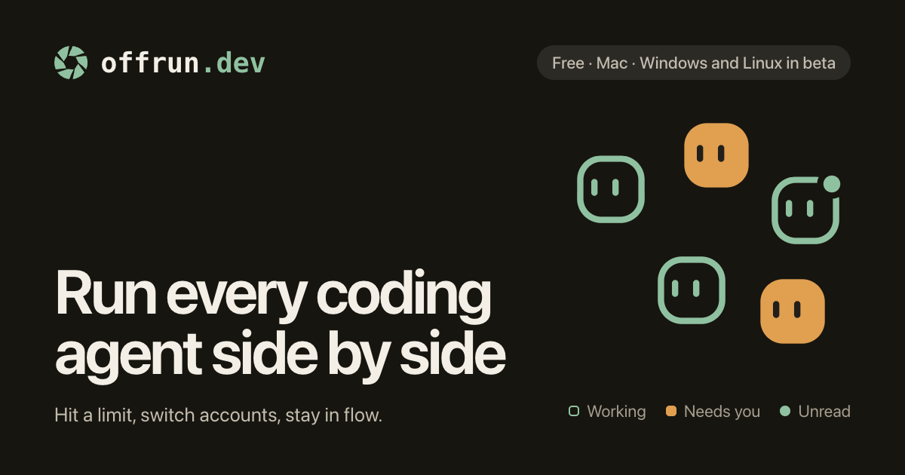

  

# Offrun

Run every coding agent side by side. Offrun is a free desktop app that runs Claude Code, Codex, Antigravity, Grok Build and Muse Code in parallel, each task in its own git worktree, signed in with the agent accounts you already have.

**[Download Offrun](https://offrun.dev/download/?utm_source=github&utm_medium=referral&utm_campaign=repo-2026-11)** · [Docs](https://offrun.dev/docs/) · [Changelog](CHANGELOG.md) · [Report a bug](https://github.com/founderly-inc/offrun/issues/new/choose)

This repository holds Offrun's release notes, its issue tracker and its discussions. The app's source code is not public.

## Download

| System | Build |
| --- | --- |
| Mac with Apple silicon (M1 or newer), macOS 14 or later | Everything. Notarized by Apple. Dictation needs macOS 26. |
| Mac with an Intel processor, macOS 14 or later | Agents, memory and connected apps. No dictation. |
| Windows 10 or 11, 64-bit (beta) | Setup .exe, signed by Founderly, Inc. Installs without administrator rights. |
| Linux, x64 and ARM64 (beta) | .deb for Ubuntu 22.04 or later and Debian 12 or later, or an AppImage. |

Every build, its size and its SHA-256 checksum are on the [download page](https://offrun.dev/download/?utm_source=github&utm_medium=referral&utm_campaign=repo-2026-11). The Windows and Linux betas do not update themselves yet; download the new version from the same page.

## What it does

- **Five agents, one window.** Claude Code, Codex, Antigravity (`agy`), Grok Build and Muse Code, each running its own CLI on your computer with your own login.
- **No collisions.** Each task can get its own git worktree and branch, so agents on one repository do not overwrite each other's files. [How worktrees keep agents apart](https://offrun.dev/docs/worktrees/)
- **Limits are a pause, not a stop.** Add several logins per agent. When one hits its usage limit, the chat moves to the next login and you send your message again; the new login is handed the conversation so far. [Accounts and limits](https://offrun.dev/docs/limits/)
- **A second opinion before you accept.** Pick a reviewer agent, from another provider if you like. It reads the diff and reports; it never edits code. Its findings wait until you press Ask agent to fix. [Peer review](https://offrun.dev/docs/review/)
- **One memory for every agent.** Project notes that each agent reads, whichever one you start.

## Getting started

1. Install at least one agent CLI, such as Claude Code or Codex, and sign in to it with your own account. Offrun does not include them.
2. [Download Offrun](https://offrun.dev/download/?utm_source=github&utm_medium=referral&utm_campaign=repo-2026-11) and open it.
3. Create your free Offrun account (Google, or email and a password).
4. Offrun lists the agents it finds on your computer. Open a project and start a chat.

The full walk-through is in [Install](https://offrun.dev/docs/install/) and [Your first chat](https://offrun.dev/docs/first-chat/).

## Questions

**Is Offrun open source?** No. This repository is where releases are announced and where you can report bugs and ask questions. The app itself is closed source.

**What does it cost?** Offrun is free. Your agents are billed by their own providers, on your own plans or API keys.

**Where does my code go?** From your computer to the provider of the agent you chose, under your account. Offrun has no server in that path. Details: [Privacy and data](https://offrun.dev/docs/privacy-and-data/) and the [Privacy Policy](https://offrun.dev/privacy/).

**How does it compare with other apps?** See [Apps for running coding agents in parallel, compared](https://offrun.dev/compare/).

## Help and feedback

- **A bug:** [open an issue](https://github.com/founderly-inc/offrun/issues/new/choose). Please remove emails, tokens and repository names from anything you paste.
- **A question or an idea:** [start a discussion](https://github.com/founderly-inc/offrun/discussions).
- **A security problem:** see [SECURITY.md](SECURITY.md). Please do not open a public issue.
- **Anything else:** [hello@offrun.dev](mailto:hello@offrun.dev).

## Guides

- [Run coding agents in parallel without collisions](https://offrun.dev/parallel-coding-agents/)
- [Run multiple Claude Code accounts on one computer](https://offrun.dev/multiple-claude-code-accounts/)
- [Use Claude Code and Codex together](https://offrun.dev/claude-code-and-codex/)

Use of Offrun is covered by its [Terms of Service](https://offrun.dev/terms/). © 2026 Founderly, Inc.
